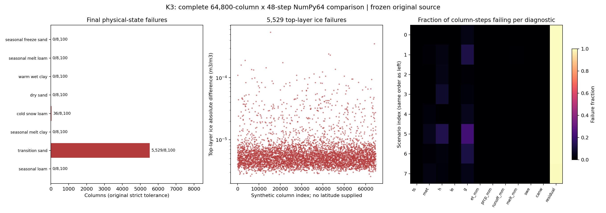
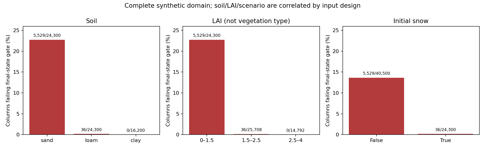
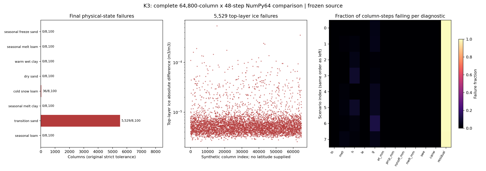

# K3：64800 柱完整对照与根因取证

M阶段补充：本轮独立全域重跑复现了下文全部5565个状态失败柱，完整64800行
记录解压SHA相同，见[回退源复验](GPU_DELTA_ATTEMPT.md)。Wang允许M1未修复时
以完整冰量归因和“冻土敏感应用建议用float64/JAX-x64”的公开限制验收域项；
原K3门仍红。下文旧“阻止main”规则已由[M2](GPU_CLOSEOUT_CRITERIA.md)替代，
当前发布阻塞是M4真实数据同输入canw未达99.5%，不把域红灯改成数值通过。

状态：**原 NumPy64 域门仍红灯。** 本轮已对全部 64800 柱 × 48 步逐值比较，
不是把原来的 15 个抽样结果外推。终态有效物理字段有 5565 柱超差，逐步诊断
64800 柱均至少一项超差；所有整数一致，GPU 原有物理边界和 0.5 W/m² 能量门通过。
未改容差、ABI 或普通版物理来掩盖此结果。K2 的年度薄雪修复不能自动关闭 K3。
下面先保留修前取证；末节给出 K2 最终修后全部 64800 柱的独立重跑，仍为红灯。

## 输入、范围和完整聚类

输入保持 `check_gpu_extended.py` 的 8 情景、seed=20261013、day=0、1800 s × 48。
GPU 为实际 RTX 4090 上的 JAX float32；NumPy64 从**同一量化后的 float32 输入**
解包，逐柱完整运行。每个情景 8100 柱。NumPy 使用 16 个独立工作进程、CPU24–39，
共 195.933425 s；这只说明取证作业已完成，不是新的性能基准。未触碰 N300000
单核监督器或其 CPU14/16/18 子作业。

这份合成输入**没有纬度、经度或植被类别**，不能画成地理失败地图。
下图横轴是明确标注的合成柱序号；土壤与 LAI 来自实际输入。真实地理 ERA5
或 FLUXNET 验证是不同任务，不能给本域补造坐标。



| 情景 | 土壤 | 初始有雪 | 终态物理字段失败柱 / 8100 | 最大逐步 Ts 差，K |
|---|---|---|---:|---:|
| seasonal_freeze_sand | sand | 否 | 0 | 0.000382038 |
| seasonal_melt_loam | loam | 是 | 0 | 0.0000871475 |
| warm_wet_clay | clay | 否 | 0 | 0.000292689 |
| dry_sand | sand | 否 | 0 | 0.00556164 |
| cold_snow_loam | loam | 是 | 36 | 0.000121268 |
| seasonal_melt_clay | clay | 是 | 0 | 0.000475502 |
| transition_sand | sand | 否 | **5529** | **0.0747771** |
| seasonal_loam | loam | 否；当天会积雪 | 0 | **2.34994058** |

终态失败是明显的**物理情景聚集**，而非所有柱均匀失败：5529 柱为无雪砂土冻融，
36 柱为厚雪覆盖下土壤冰量。按柱序号八等分分别有
676/671/696/721/692/730/698/681 个状态失败，空间序号上分散不能否定情景聚集。
非残差诊断还存在少量大幅尾部，不能把它们全称为 1e-3 W/m² 的量化噪声。
另一方面，residual 的原绝对近零门在各情景都普遍失败，属于另一个误差维度。

| 分组 | 总柱数 | 终态物理字段失败柱 |
|---|---:|---:|
| sand / loam / clay | 24300 / 24300 / 16200 | 5529 / 36 / 0 |
| 初始无雪 / 有雪 | 40500 / 24300 | 5529 / 36 |
| LAI [0,1.5) / [1.5,2.5) / [2.5,4) | 24300 / 25708 / 14792 | 5529 / 36 / 0 |

LAI 与情景/土壤在这份设计中相关，上表不能证明植被本身是独立因果变量。
完整逐柱记录包含土壤、LAI、初始/终态 SWE、失败 ABI、土温与冰量，见
[64800行压缩CSV](gpu-results/k3-domain-original-columns.csv.gz)。



| 诊断 | 3110400 个柱步中的原门失败项 | 最大绝对差 |
|---|---:|---:|
| ts | 30 | 2.34994058 K |
| rnet | 48661 | 9.94350659 W/m² |
| h | 134334 | 10.78663334 W/m² |
| le | 628 | 0.06401396 W/m² |
| g | 250337 | 2.65781466 W/m² |
| et_mm | 183 | 6.41956e-6 mm |
| prcp_mm | 0 | 8.62783e-8 mm |
| runoff_mm | 0 | 0 mm |
| melt_mm | 3033 | 7.58127e-6 mm |
| swe | 0 | 2.46467e-8 m |
| canw | 0 | 0 m |
| residual | 3102205 | 0.0145839123 W/m² |

终态有效状态失败为 `tsoil[0]` 2 项、`soil_ice[0]` 5529 项、
`soil_ice[1]` 1 项、`soil_ice[2]` 35 项；tsoil 失败所在柱已包含于冰量失败柱，
故总失败柱仍为 5565。有效雪层沿用 H2 mask，未把无效层填充值计作物理错误。
原门保持 `atol=1e-6, rtol=1e-4`。

## 根因一：土温误差在表观热容的截断区被放大

对全部 5565 个超差冰量元素做了精确的加减项分解。令 `I64(w,T)` 为同一
普通版 Niu–Yang 冰量公式、`I32` 为 GPU 报告值：

```
I32 − I64(w64,T64)
 = [I32 − I64(w32,T32)]
 + [I64(w32,T32) − I64(w32,T64)]
 + [I64(w32,T64) − I64(w64,T64)]
```

三项分别是公式评价、温度轨迹、水量轨迹。重组残差和普通版公式重算误差均为零。
**5565/5565 项中，温度轨迹项绝对值都大于另两项绝对值之和**。
失败元素上的各项最大绝对值分别为 1.59300e-7、5.42499678e-4、1.43456e-7 m³/m³。
因此已排除“冰量反推公式本身算错”作为这些终态差异的主要来源；它们来自土温轨迹。
完整分解见[JSON](gpu-results/k3-domain-original-ice-decomposition.json)和
[5565行证据](gpu-results/k3-domain-original-ice-rows.jsonl.gz)。

随后选取 13 个尾部/原样本柱，保存每步完整状态和强迫；加入 trace 输出后，
这 13 柱的全部 48 步诊断与原 N64800 输出**逐位相同**，因此定位没有因改 batch
形状而换成另一个失败。[trace输入和输出](gpu-results/k3-domain-original-tail-trace.npz)、
[逐位检查](gpu-results/k3-domain-original-tail-trace.json)。

最小热敏感例为 **col49974、step20（均从零计数）**：

| 同一 NumPy64 热求解器，仅换该步输入状态 | 原 NumPy 轨迹输入 | 实测 GPU 轨迹输入 |
|---|---:|---:|
| 旧顶层温度 K | 272.485847397 | 272.486511230 |
| 顶层表观热容 J/(m³ K) | 1997036.3704 | 1758062.8649 |
| 顶边 G W/m² | 126.551299653 | 126.542568789 |
| double 热求解后的顶层温度 K | 273.985134596 | 274.179141132 |

旧温度仅差 0.000663833 K，AHC 已差约 12%；用**同一个 double 热求解器**仍产生
0.194006536 K 的新温度差。真实 GPU 新温度为 274.184844971 K，与 NumPy 轨迹差
0.199710375 K。这证明主要放大机制不要求“float32 Thomas 直接算出 0.2 K 错误”。
AHC 使用 `liquid(T+0.02)-liquid(T-0.02)`，而未冻水又受总水量 `min` 截断；
采样窗跨该截断附近时，微小旧状态差会显著改变本步有效热容。

col15414 的 step21、step42 独立复现相同放大：后者旧温度差 0.000457690 K，
热容从 2983498.726 变为 2785354.321 J/(m³ K)。最后顶层土温差 −0.0337160873 K，
冰量差 5.42444015e-4 m³/m³，是本域最大终态冰差；全程相关柱无雪。
[逐次冻结状态探针](gpu-results/k3-domain-original-causal.json)保留完整四层状态。

这已识别出一个具有相变截断敏感性的数值路径，**尚未证明更换 AHC 或热积分算法
能满足原门**。不能未经新推导和验证就改普通版方程，也不能把这条证据写成已修复。
更高精度热容量、增量式热解或守恒焓法是后续可检验方向；不是本轮已采纳结论。

36 个厚雪冻土失败需要与上述 5529 个砂土冻融失败区分：这些列雪下土壤边界
G=0、四层初温均为 268 K，NumPy 终态仍在
`[267.99999999999807, 268.00000000000284] K`，GPU 对应土温差却最大
0.002288818359 K。SWE 都保持约 0.2000000104 m。这里均温绝热状态的准确解
应保持均温；float32 直接求绝对温度的 Thomas 消去/回代累计了非零漂移，
随后由冰量反推显现为超差。该子集是**均温不变量的数值保持问题**，无需跨 AHC
截断即可出现，不能把全部 5565 项笼统归为相变瞬时放大。增量式土热求解值得
单独验证此不变量，但本轮没有未经验收就写进生产。

## 根因二：雪面割线停止路径对近零函数形状敏感

最大瞬时 Ts 差来自 **col5063、step44**，其前一步 SWE 约 0.0288 m，
不是年度第 3 天那个 0.00129 m 薄雪过冷状态。
NumPy 返回 267.281825343 K，残差 −0.000911646620 W/m²，满足原求根停止标准。
GPU 返回 264.931884766 K；两者相差 2.349940578 K，H 相差 10.786633345 W/m²。

对**同一 NumPy64 冻结状态的 F** 做 260–273 K、0.005 K 网格扫描并对符号区间
二分，在 264.931893142 K 找到残差 −1.77e-13 W/m² 的根。
普通版提前返回的位置附近，有限次 MOST 评价的 F 已接近停止阈值；一个合法的
“小残差停止点”与另一个符号根可以相距数 K。这里不根据有限网格宣称根唯一。
把前态换成实测 GPU 前态，再用普通 double F/割线运行，仍返回 267.283796949 K，
说明大跳变并非由前一步雪态已差数 K 导致。

本例说明：只有能量残差小并不足以保证温度根的后端可重复性。混合精度 F/割线
可能改善这条路径，但需要实测，不能据此直接采用；更不能把根区间扩大当修复。
K2 改变雪面耦合后也必须重新检查这条尾部，而非预设它自然消失。

## 可复核证据与重跑

完整原始数组仍在 xuanze：
`/home/lhwang/work/noahmp-phase3b/logs/k3-domain-full-original-v2/`，含所有输入、
GPU/NumPy 的全部逐步诊断和终态 NPY、逐柱压缩 CSV、聚类、分解与最小 trace。
冻结源码目录为 `/home/lhwang/work/noahmp-phase3b/k3-domain-frozen/`，从
`f7165482fd12248a59eaffac0d529aef2b462468` 归档；该提交比用户给的 9a0ce06 晚，
是开工时实际分支 HEAD，因此以完整[源码哈希记录](gpu-results/k3-domain-original-summary.json)
为准，不把它冒称成 9a0ce06。GPU 与 CPU 运行的物理源 hash 相同。
GPU 首次启动遇系统 LD_LIBRARY_PATH 指向不匹配 cuSPARSE，立即按现有环境文档
清除该变量后成功；失败目录没有被覆盖或算成数据。

新增仪器 [forensic_gpu_domain.py](../benchmarks/forensic_gpu_domain.py) 的调用顺序：

```bash
cd /home/lhwang/work/noahmp-phase3b/k3-domain-frozen
env -u LD_LIBRARY_PATH PYTHONPATH=src CUDA_VISIBLE_DEVICES=0 JAX_PLATFORMS=cuda \
  JAX_ENABLE_X64=true XLA_PYTHON_CLIENT_PREALLOCATE=false \
  /home/lhwang/venvs/noahmp-phase3b/bin/python benchmarks/forensic_gpu_domain.py \
  gpu --directory ../logs/k3-domain-NEW
PYTHONPATH=src OMP_NUM_THREADS=1 OPENBLAS_NUM_THREADS=1 MKL_NUM_THREADS=1 \
  /home/lhwang/venvs/noahmp-phase3b/bin/python benchmarks/forensic_gpu_domain.py \
  cpu --directory ../logs/k3-domain-NEW
PYTHONPATH=src /home/lhwang/venvs/noahmp-phase3b/bin/python \
  benchmarks/forensic_gpu_domain.py summarize --directory ../logs/k3-domain-NEW
```

随后同目录运行 `decompose`、`trace`、`causal`；`trace` 需要实际 CUDA，`causal`
只需 CPU。最小根因复现只需将保存的 13 柱 trace 放为新目录的 `tail-trace.npz`，
在对应冻结源码上运行 `causal`，不必重跑 64800 柱。

## K2 最终修后：完整域重跑仍失败

从 K2 的 `k2-final` 复制独立源码到
`/home/lhwang/work/noahmp-phase3b/k3-domain-post-k2/`，重新运行全部 GPU 输出，
再对全部 64800 柱运行修后的 NumPy64 参考；不是沿用旧参考，也不是抽样。
NumPy 部分耗时 193.696162 s。GPU0 同时有年度小 N 审计，本次只作正确性取证，
不作任何性能结论。GPU 与 CPU 的全部物理源哈希一致，最终 `summarize` 返回
**exit 1、passed=false**。

| 完整域原门 | 修前 | K2 最终修后 |
|---|---:|---:|
| 诊断失败柱 | 64800 | 64800 |
| 终态有效状态失败柱 | 5565 | 5565 |
| 整数不一致柱 | 0 | 0 |
| 顶层冰量失败项 | 5529 | 5529 |
| 最大逐步 Ts 差 K | 2.349940578 | **0.074777108** |
| 最大 H 差 W/m² | 10.786633345 | **2.293825647** |
| 最大 G 差 W/m² | 2.657814658 | 2.657814658 |
| residual 失败项 | 3102205 | 3101237 |
| 最大 residual 差 W/m² | 0.0145839123 | 0.0145839123 |
| GPU 物理边界与绝对能量门 | 通过 | 通过 |

修后的逐诊断失败项为：Ts 29、rnet 38834、H 103732、LE 628、G 157524、
ET 183、融雪 2772、residual 3101237；降水、径流、SWE、冠层水仍无超差。
全部状态失败 mask 与修前**完全相同**，四层冰量的逐值绝对误差数组也**逐位相同**。
5529 无雪砂土冻融与 36 厚雪土温不变量问题均没有被雪面边界修复改变。

K2 的改动明显消除了旧 `seasonal_loam` 组的 2.35 K 尾部：该组最大 Ts 差现在为
0.003977719 K；全域最大 Ts/H 尾部转由无雪 `transition_sand` 主导。
这支持将 K2 与 K3 土热精度缺口分开验收，不能因年度稳定性修好就将域门改绿。



修后证据：[完整汇总及源码哈希](gpu-results/k3-domain-post-k2-summary.json)、
[64800列记录](gpu-results/k3-domain-post-k2-columns.csv.gz)、
[逐列逐字段误差](gpu-results/k3-domain-post-k2-column-errors.npz)、
[冰量分解](gpu-results/k3-domain-post-k2-ice-decomposition.json)。完整原始 NPY 保留于
`/home/lhwang/work/noahmp-phase3b/logs/k3-domain-full-post-k2/`。
本次关键源身份为 JAX `af3f9dd5…`、CUDA `b514c3b8…`、driver `4d500860…`、
snow `e56b1392…`；CUDA hash 是快照身份，**本域实际运行后端仍为 JAX32**，
不将它写成 CUDA 域也已运行。

K3 交付为完整域重跑失败证据、图和可重复根因文档，**尚无通过证据**。
单点数值方向到达 30 分钟后已停止盲目调参/改算法，转为完整取证和 K2 修后复验；
后续需要经过独立推导的土热数值修复及原门实测，当前继续阻止 main 合并。
